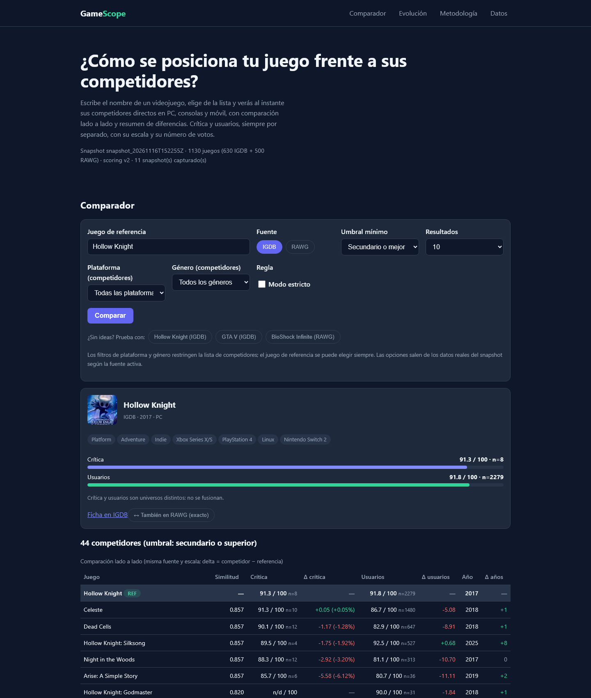
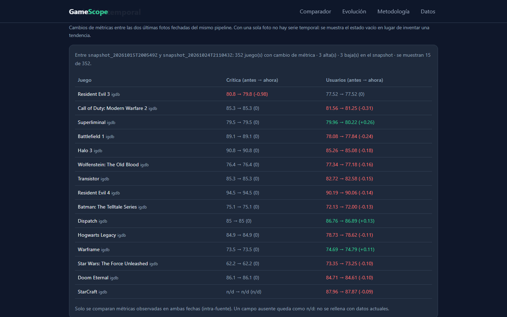

# GameScope

**Cómo se posiciona un videojuego frente a sus competidores directos, cruzando IGDB, RAWG y CheapShark sin mezclar escalas.**

[](https://gamescope-comparador.vercel.app) [](https://github.com/alvarodc093-pixel/GameScope/actions/workflows/weekly_snapshot.yml)  



- **Problema:** las notas de prensa y de usuarios están en sitios distintos, con escalas y número de votos distintos, y nadie las pone lado a lado por plataforma.
- **Datos:** 1.130 juegos (630 de IGDB y 500 de RAWG) con precios de PC de CheapShark, en un snapshot nuevo cada lunes.
- **Resultado:** una puntuación explicable elige los competidores de un juego. Para Hollow Knight salen 44 de 629 (Celeste, Dead Cells, Silksong…). La web compara notas, votos y años, y muestra qué ha cambiado entre snapshots.
- **Ingeniería:** pipeline en Python orquestado con GitHub Actions, 69 tests, y la misma regla de scoring en Python y en JavaScript, con un test que comprueba que dan la misma nota.

## El problema

Quien sigue el mercado (un estudio pequeño, una tienda, un analista) no tiene una forma rápida de responder a "¿cómo se posiciona este juego frente a sus competidores?". La nota de crítica de un juego dice poco sin la de juegos parecidos de la misma plataforma y época, medida en la misma escala.

## Datos

| Fuente | Qué aporta | Acceso |
|---|---|---|
| [IGDB](https://api-docs.igdb.com) (principal) | Géneros, plataformas, fechas, estudios y notas de crítica y de usuarios con su número de votos | OAuth2 de Twitch |
| [RAWG](https://rawg.io/apidocs) | Segunda fuente de notas (Metacritic y usuarios en escala 0–5) | API key gratuita |
| [CheapShark](https://apidocs.cheapshark.com) | Precio actual en PC (USD) | Sin clave |

- **Tres capas:** los más populares por plataforma (PC, Sony, Microsoft, Nintendo y móvil; Switch 2 solo en IGDB), una capa intermedia y unos 500 juegos de cola larga elegidos al azar (en IGDB, ≤ 50 votos).
- **Snapshots** en `data/snapshots/`: uno por ejecución, con hora UTC en el nombre y un `.meta.json` con cobertura y rango de `observed_at`. Nunca se sobrescriben. El recuento y la fecha del último están en [`web/data/meta.json`](web/data/meta.json).
- **Las fuentes no se fusionan:** cada nota se muestra en su escala y con su número de votos. Si un juego está en las dos, se enlaza (mismo nombre normalizado y como mucho 2 años de diferencia, para no confundir un remake con el original).

El detalle de cómo se validaron y eligieron las fuentes está en [`docs/`](docs/).

## Hallazgos del análisis

Del notebook [`notebooks/02_eda.ipynb`](notebooks/02_eda.ipynb), sobre los 638 juegos únicos de las capas top e intermedia del snapshot del 16/11/2026:

- Crítica y usuarios van bastante juntos (Pearson 0,61 en RAWG y 0,67 en IGDB), pero con un número de votos muy distinto: la crítica de IGDB tiene una mediana de 11 reseñas, los usuarios llegan a miles.
- Casi todo es multiplataforma (99 % en RAWG y 96 % en IGDB): sin filtrar por plataforma, PC, PlayStation y Xbox muestran casi el mismo catálogo.
- Un género domina cada fuente: `Action` en el 77 % de los juegos de RAWG y `Adventure` en el 68 % de IGDB. Compartirlo no dice casi nada, y por eso el scoring pondera los géneros por rareza.
- La cobertura de crítica cae en la cola larga: del 95 % al 79 % en RAWG y del 84 % al 73 % en IGDB.
- RAWG no da desarrollador ni editor en sus listados: hay que pedir la ficha de cada juego.

## Cómo se eligen los competidores

`src/scoring.py`, replicado en `web/js/scoring.js`. Solo compara juegos de la misma fuente, y sin género o plataforma en común no hay competidor.

| Componente | Peso | Cálculo |
|---|---|---|
| Género | 3 | Jaccard ponderado por rareza: cada género pesa `log(N / juegos que lo tienen)`, así que compartir Platform cuenta mucho más que compartir Adventure |
| Plataforma | 2 | 1 si comparten dos o más, 0,5 si una |
| Época | 1 | 1 si se llevan ≤ 2 años, 0,5 si ≤ 4 |
| Estudio | 1 | Solo si los dos lo tienen (RAWG no lo da en el listado) |

Tiers: directo ≥ 0,75, secundario ≥ 0,60, relacionado ≥ 0,40. Cada competidor sale con lo que aportó cada componente. El **modo estricto** exige además año conocido y al menos dos géneros en común.

La primera versión daba 0,6 por compartir cualquier género. Con eso, la mediana de competidores directos o secundarios de un juego era el 56 % del catálogo de IGDB, y a Hollow Knight le salían 440. Con la ponderación por rareza la mediana baja al 3 % en IGDB y al 12 % en RAWG, cuyos géneros son pocos y muy amplios. El caso completo está en [`docs/08_caso_prueba.md`](docs/08_caso_prueba.md).

`tests/test_paridad_js.py` ejecuta la versión JavaScript con Node y comprueba que da la misma nota y el mismo tier que la de Python, en casos sintéticos y sobre el último snapshot.

## La web



Web estática (HTML, CSS y JavaScript sin dependencias) en `web/`, generada a partir del último snapshot:

- Buscador con autocompletado, fuente (IGDB o RAWG), umbral, filtros de plataforma y género, y modo estricto.
- Tabla de diferencias frente a cada competidor (crítica, usuarios y años) y un resumen: mediana del grupo, cuántos superan al juego elegido y avisos sobre lo que los datos no dicen.
- Precio en PC cuando lo hay, con su fecha de observación.
- Evolución entre los dos últimos snapshots: juegos que entran y salen de la muestra y cambios en sus notas.

No llama a las APIs en vivo, así que no necesita claves.

## Automatización

`.github/workflows/weekly_snapshot.yml` repite el pipeline cada lunes (muestreo, snapshot, cruce entre fuentes, precios y exportación a la web), pasa los tests y hace commit de los datos nuevos si los tests pasan. Necesita tres secretos en el repositorio: `RAWG_API_KEY`, `IGDB_CLIENT_ID` e `IGDB_CLIENT_SECRET`.

## Ejecutarlo

```bash
pip install -r requirements.txt
cp .env.example .env               # y rellena las tres claves

python -m src.check_connections    # comprueba IGDB y RAWG (sin imprimir claves)
python -m src.muestreo             # juegos más populares por plataforma
python -m src.muestreo_midtail     # capa intermedia
python -m src.muestreo_longtail    # cola larga (acumulativa, máximo 500)
python -m src.snapshot             # snapshot fechado
python -m src.matching             # enlace entre IGDB y RAWG
python -m src.precios              # precios de PC en CheapShark
python -m src.export_web           # datos de la web

python -m src.scoring --slug hollow-knight --source igdb   # competidores de un juego
python -m unittest discover tests  # sin llamadas a las APIs; la paridad con JS necesita Node
cd web && python -m http.server    # o abrir web/index.html directamente
```

## Estructura

```text
├── src/          # acceso a APIs, muestreo, snapshot, cruce, precios, scoring y exportación
├── tests/        # tests unitarios y de paridad Python/JavaScript
├── notebooks/    # auditoría de datos y EDA
├── web/          # aplicación estática
├── data/
│   ├── processed/  # muestras, cruce entre fuentes y precios
│   └── snapshots/  # fotos fechadas
└── docs/         # validación de fuentes, decisiones, diccionario, KPIs y metodología
```

## Limitaciones

- La muestra parte de los juegos más populares, así que las notas medias son altas.
- Las métricas de la cola larga se observaron una vez (15/10/2026) y no se vuelven a consultar: en la evolución entre snapshots esos juegos nunca cambian.
- El pipeline no reintenta las llamadas a las APIs ni valida los datos antes del commit: si una API falla, se pierde esa semana (pasó el 9/11/2026).
- Dos juegos con exactamente los mismos géneros sacan la nota máxima de género aunque esos géneros sean comunes; afecta sobre todo a RAWG, que tiene pocos.
- El enlace entre fuentes se basa en el nombre y el año; no se ha medido su precisión con una revisión manual.
- La equivalencia de géneros entre fuentes es aproximada (por ejemplo, Action frente a Adventure).
- Notas y votos no son ventas. El precio es solo de PC y en dólares; no hay fuente comparable para consolas.

## Autor

Álvaro Domingo Cordón · [LinkedIn](https://www.linkedin.com/in/alvaro-domingo/) · [GitHub](https://github.com/alvarodc093-pixel)
