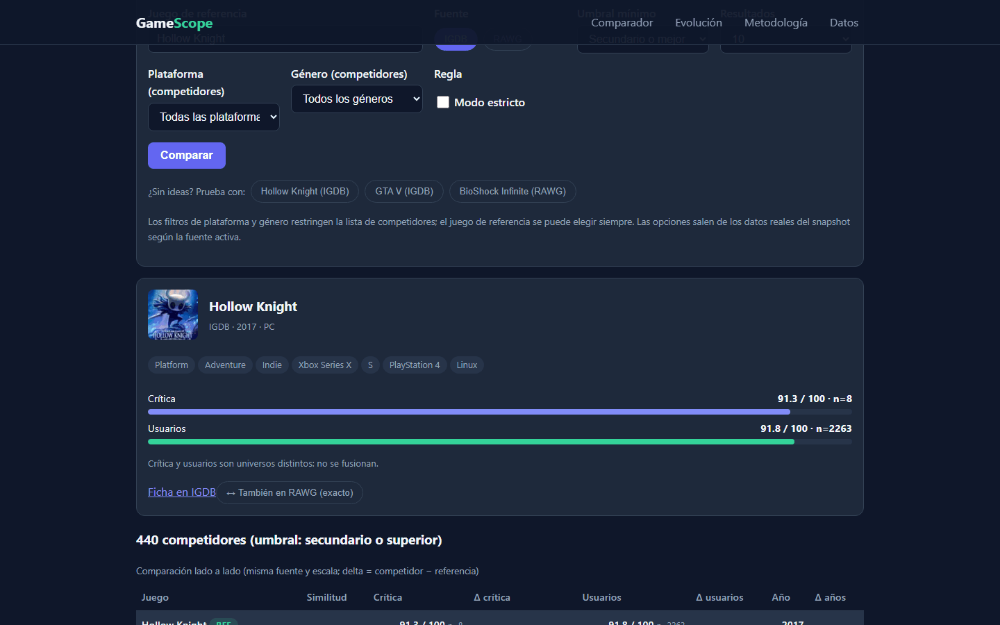
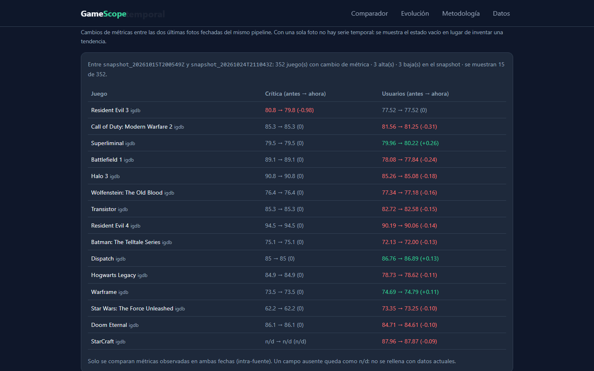

# GameScope

**Cómo se posiciona un videojuego frente a sus competidores directos, cruzando IGDB, RAWG y CheapShark sin mezclar escalas.**

[](https://gamescope-comparador.vercel.app) [](https://github.com/alvarodc093-pixel/GameScope/actions/workflows/weekly_snapshot.yml)   



## En resumen

- **Problema:** las notas de prensa y de usuarios viven en sitios distintos, con escalas y número de votos distintos, y nadie las pone lado a lado por plataforma.
- **Datos:** 1.131 juegos de IGDB y RAWG con precios de CheapShark, en snapshots semanales fechados.
- **Resultado:** una puntuación configurable elige los competidores y explica por qué; la web compara notas, votos y años, y muestra qué ha cambiado entre semanas.
- **Ingeniería:** pipeline de muestreo, cruce entre fuentes y exportación automatizado con GitHub Actions y cubierto por 61 tests.

## El problema

Quien sigue el mercado (un estudio pequeño, una tienda, un analista) no tiene una forma rápida de responder a "¿cómo se posiciona este juego frente a sus competidores?". Las notas de prensa y de usuarios viven en sitios distintos, con escalas y número de votos distintos, y nadie las pone lado a lado por plataforma.

## Datos

| Fuente | Qué aporta | Acceso |
|---|---|---|
| [IGDB](https://api-docs.igdb.com) (principal) | Juegos, géneros, plataformas, fechas y notas de crítica y usuarios | OAuth2 de Twitch |
| [RAWG](https://rawg.io/apidocs) | Segunda fuente de notas, y desarrollador y editor desde la ficha | API key gratuita |
| [CheapShark](https://apidocs.cheapshark.com) | Precio actual en PC (USD) | Sin clave |

- **1.131 juegos** (630 de IGDB y 501 de RAWG) en tres capas: los más populares por plataforma (PC, Sony, Microsoft, Nintendo, móvil y Switch 2), una capa intermedia y una muestra aleatoria de la cola larga.
- **Snapshots fechados y acumulativos** en `data/snapshots/`: cada captura es una foto completa con su hora en UTC y un `.meta.json` de trazabilidad. La última es del 24/10/2026 y hay 5.
- Las dos fuentes **no se fusionan**: cada nota se muestra en su propia escala y con su número de votos. Cuando un juego está en las dos, se enlaza (mismo nombre normalizado y como mucho 2 años de diferencia, para no confundir un remake con el original).

El detalle de cómo se validaron y eligieron las fuentes está en [`docs/`](docs/).

## Hallazgos del análisis

Del notebook [`notebooks/02_eda.ipynb`](notebooks/02_eda.ipynb), con la muestra principal (1.150 juegos):

- Las notas de crítica y de usuarios van bastante juntas (correlación de 0,64 en RAWG y 0,68 en IGDB), pero con un número de votos muy distinto: la crítica de IGDB tiene una mediana de 12 reseñas, los usuarios llegan a miles.
- Casi todo es multiplataforma (99 % en RAWG y 98 % en IGDB), así que sin filtrar por plataforma cualquier comparación mezcla mercados.
- La cobertura de crítica cae fuera del top: de un ~95 % a un ~79 % en RAWG y de un ~90 % a un ~73 % en IGDB.
- RAWG no da desarrollador ni editor en sus listados: hay que pedir la ficha de cada juego.

## Cómo se eligen los competidores

Una puntuación configurable (`src/scoring.py`) combina género y plataforma (obligatorios), cercanía en el año de lanzamiento y estudio en común si se conoce. Cada competidor sale con una explicación de por qué lo es. El **modo estricto** exige además año conocido y al menos dos géneros en común. La misma regla está replicada en JavaScript (`web/js/scoring.js`) y hay tests que comprueban ambas.

## La web



Web estática (HTML, CSS y JavaScript sin dependencias) en `web/`, generada a partir del último snapshot:

- Buscador con autocompletado, fuente (IGDB o RAWG), umbral de parecido, filtros de plataforma y género, y modo estricto.
- Tabla de diferencias frente a cada competidor (crítica, usuarios y años) y un resumen: mediana del grupo, cuántos superan al juego elegido y avisos sobre lo que los datos no dicen.
- Precio en PC cuando lo hay, con su fecha de observación.
- **Evolución** entre los dos últimos snapshots: juegos que entran y salen de la muestra y cambios en sus notas.

No llama a las APIs en vivo, así que no necesita claves.

## Automatización

`.github/workflows/weekly_snapshot.yml` repite todo el pipeline cada lunes (muestreo, snapshot, cruce entre fuentes, precios y exportación a la web), pasa los 61 tests y solo hace commit si todo va bien. Necesita tres secretos en el repositorio: `RAWG_API_KEY`, `IGDB_CLIENT_ID` e `IGDB_CLIENT_SECRET`.

## Ejecutarlo

```bash
pip install -r requirements.txt
cp .env.example .env               # y rellena las tres claves

python -m src.check_connections    # comprueba IGDB y RAWG (sin imprimir claves)
python -m src.muestreo             # juegos más populares por plataforma
python -m src.muestreo_midtail     # capa intermedia y fichas de RAWG
python -m src.muestreo_longtail    # cola larga (acumulativa, máximo 500)
python -m src.snapshot             # snapshot fechado
python -m src.matching             # enlace entre IGDB y RAWG
python -m src.precios              # precios de PC en CheapShark
python -m src.export_web           # datos de la web

python -m unittest discover tests  # 61 tests, sin llamadas a las APIs
cd web && python -m http.server    # o abrir web/index.html directamente
```

## Estructura

```text
├── src/          # acceso a APIs, muestreo, snapshot, cruce, precios, scoring y exportación
├── tests/        # 61 tests
├── notebooks/    # auditoría de datos y EDA
├── web/          # aplicación estática
├── data/
│   ├── processed/  # muestras, cruce entre fuentes y precios
│   └── snapshots/  # fotos fechadas
└── docs/         # validación de fuentes, decisiones, diccionario, KPIs y metodología
```

## Limitaciones

- La muestra parte de los juegos más populares, así que las notas medias son altas.
- La equivalencia de géneros entre fuentes es aproximada (por ejemplo, Action frente a Adventure).
- Notas y votos no son ventas.
- El precio es solo de PC y en dólares; no hay fuente comparable para consolas.
- El enlace entre fuentes se basa en el nombre y el año; los casos dudosos no se han revisado a mano.

## Autor

Álvaro Domingo Cordón · [LinkedIn](https://www.linkedin.com/in/alvaro-domingo/) · [GitHub](https://github.com/alvarodc093-pixel)
